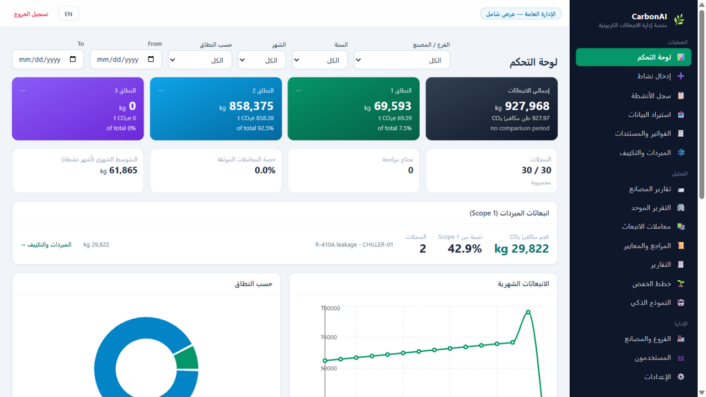
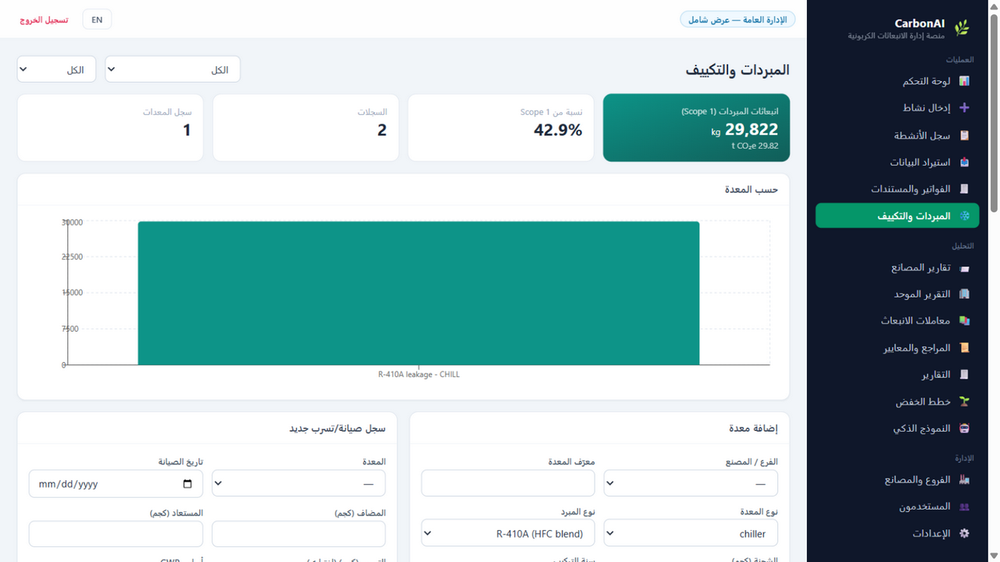
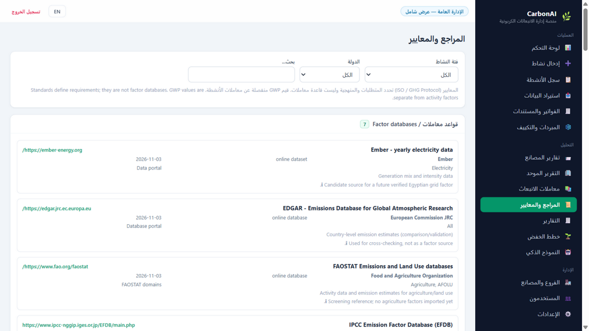

# CarbonAI

Production-ready Carbon Emissions Management System for multi-branch / multi-factory
organizations: React frontend + FastAPI REST backend on top of the original, tested
Decimal calculation engine.

> See `IMPLEMENTATION_REPORT.md` for the full upgrade story: what the original project
> contained, what was found, what changed and what was verified.

## Quick start (Windows)

Double-click **`START_CARBONAI.bat`**, then open http://127.0.0.1:8000

- First run creates the default admin: **admin / admin123** (change it after first login —
  the app forces it). Set the `CARBONAI_ADMIN_PASSWORD` environment variable to choose the
  initial password yourself.
- The SQLite database lives at `data\carbonai.db`; schema migrations are additive and an
  automatic backup is taken before any migration of an existing DB.

## What the system does

| Area | Details |
|---|---|
| Calculation engine | Deterministic Decimal engine (activity × factor), dimension-checked unit conversion, GWP sets (AR4/AR5), per-gas component math — unchanged from the original core |
| Factor library | Versioned emission factors with sources, ranked suggestion (national > regional > global > proxy), verification workflow with audit log; only verified national factors auto-apply |
| Egypt factors | Source-backed Egyptian database: EEHC 2023/2024 official figure (380.3 t CO₂/GWh thermal) + IPCC 2006/AR5 defaults, four-way classification, 2006–2026 coverage matrix (explicit pending years), admin-only management |
| Scope classification | Rule-based GHG Protocol Scope 1/2/3 suggestion that states its missing information instead of guessing |
| Multi-factory | Organizations (companies) with branches/factories; factory users are isolated to their own facility |
| Reporting workflow | Factories snapshot a period into a submission; head office approves/rejects; one active submission per facility/period; consolidated report counts approved snapshots only |
| Dashboard | Total + Scope 1/2/3 KPI cards with share % and previous-period change, monthly/annual trends, facility/category comparisons, top sources |
| Intelligent import | Arabic/English synonym recognition + fuzzy matching + mapping UI, per-row factor preview, SHA-256 duplicate-file protection |
| Invoices & documents | Manual entry + validated upload, PDF text extraction (candidates for review), engine-based calculation, searchable archive, duplicate prevention, void-with-audit |
| Reports | CSV, PDF (EN/AR), detailed management PDF with embedded charts, annual reports with multi-year comparison |
| Reduction plans | Data-driven insights from actual emissions, referenced suggestions, targets and a multi-year actual-vs-target roadmap |
| ML | Row-level estimator + monthly/annual forecasting lifecycle (dataset fingerprint, chronological evaluation vs baseline, staged→admin-activated versions); no model ships until trained on real data |
## 🖼️ System Screenshots

### 1. Dashboard & Refrigerant KPIs


---

### 2. Refrigerants Management Module


---

### 3. Reference Library & Emission Factors

## Roles

| Role | Scope |
|---|---|
| `admin` | Everything, including users, factor verification, settings, backup |
| `head_office` | Own company only: consolidated dashboards, all facilities' data, review submissions |
| `factory_manager` | Own facility only: enter records, submit reports, own dashboards |
| `viewer` | Read-only inside its facility |

## 🏗️ Architecture & Directory Structure

```plaintext
CarbonAI/
├── 📄 START_CARBONAI.bat       # One-click startup script (Backend + Frontend)
├── 📄 requirements.txt         # Core Python dependencies & ML libraries
├── 📄 README.md                # Project documentation & overview
│
├── 📂 api/                     # FastAPI REST Layer
│   ├── main.py                 # REST API entry point & CORS configuration
│   └── routers/                # Domain routers (Auth/JWT, RBAC, Calculations, Reports, ML)
│
├── 📂 services/                # Framework-Free Business & AI Logic
│   ├── calculation.py          # Deterministic GHG calculation engine (Scope 1, 2, 3)
│   ├── scope_classifier.py     # Rule-based GHG protocol scope classifier
│   ├── factor_library.py       # Versioned emission factors & verification workflow
│   ├── ml_model.py             # Predictive AI models & evaluation lifecycle
│   └── audit_logger.py         # System auditing & data integrity tracking
│
├── 📂 db/                      # Persistence & Database Architecture
│   ├── schema.sql              # Relational schema & indexes
│   ├── engine.py               # SQLite / DuckDB session management
│   └── migrations/             # Safe additive schema migrations & automated backup
│
├── 📂 database/                # Reference Data & Seeding
│   └── seed/                   # Official emission factors (EEHC 2023/2024, IPCC 2006/AR5)
│
├── 📂 frontend/                # Production React UI (Full RTL / AR & EN Support)
│   ├── src/
│   │   ├── components/         # Reusable UI components, charts & KPI cards
│   │   ├── pages/              # Analytics dashboards, Refrigerants & Reports pages
│   │   └── services/           # API integration layer
│   ├── package.json            # Node.js dependencies (React 18, Vite, Tailwind, Recharts)
│   └── vite.config.ts          # Vite bundler & development proxy settings
│
├── 📂 docs/                    # System Documentation & Visual Assets
│   ├── screenshots/            # Dashboard UI previews & screenshots
│   └── IMPLEMENTATION_REPORT.md # Technical implementation report
│
├── 📂 scripts/                 # Management & Administration Utilities
│   ├── db_admin.py             # Database administration & backup/restore
│   ├── run_tests.py            # Automated testing runner
│   └── train_emission_model.py # ML model training pipeline
│
└── 📂 tests/                   # Automated Testing Suite (105 Tests)
    ├── unit/                   # 79 core calculation & DB tests
    └── e2e/                    # 26 end-to-end FastAPI API integration tests

## Development

```powershell
# backend API only
python -m uvicorn api.main:app --reload --port 8000

# frontend dev server (proxies /api to :8000)
cd frontend
npm install
npm run dev        # http://localhost:5173
```

## Tests

```
python scripts\run_tests.py     # 105 tests
```

## ML model

No model ships with the project. Once the ledger holds ≥ 40 calculated records, an
administrator can train one from the organisation's own data
(`python scripts\train_emission_model.py`, or POST `/api/ml/train`). The bundle is saved to
`models\emission_model.pkl` and served at `GET /api/ml/status` + `POST /api/ml/predict`.
Predictions are planning estimates only — the deterministic engine always stays authoritative.

## Data safety

* Startup only runs `CREATE ... IF NOT EXISTS` / `INSERT OR IGNORE` (a test enforces no
  DROP/DELETE in init/seed).
* Records are never deleted; corrections are explicit scope overrides + audit log.
* Backup: Settings page button, `POST /api/settings/backup`, or
  `python scripts\db_admin.py backup` → `backups\`.
* Restore: `python scripts\db_admin.py restore backups\<file>.db` (current DB saved aside first).
---

## 👤 إعداد وتطوير (Author & Developer)

**إيمان أحمد (Eman Ahmed)**  
*Data Analyst, BI Developer & AI Practitioner*